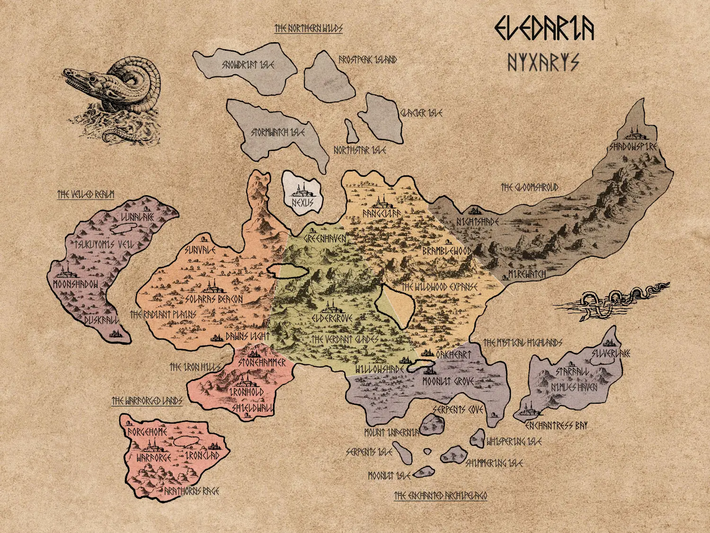

# Atlas of Eledoria: the continent of Nyxarys (draft)

Source: the author's map concept. Each region of the world reflects one of the
pantheon (`CREATION_OF_ELEDORIA.md`): its land, its people, its orders and
its monsters are shaped by the god who holds it. This is a first draft to
edit - names on the map are canon; everything else is proposal.

> Names: the world is **Eledoria** (the map's title should read so). The
> continent is **Nyxarys**, formed from the body of the goddess **Nyxara**
> when she was shattered - its regions roughly follow her body, and each god
> holds the part they were born from.

## Nyxarys: the body of Nyxara (proposal)

| Part of Nyxara | God born from it | Region of Nyxarys | Shape on the map |
|---|---|---|---|
| eyes | Solara | **The Radiant Plains** | the face of the continent, turned west toward the setting sun |
| mind | Tsukuyomi | **The Veiled Realm** | the crescent beyond the eyes, cut off by water - thought apart from the body |
| lungs | Elandria | **The Verdant Glades** | the chest at the centre; the forests breathe for the world |
| stomach | Fenrisulfr | **The Wildwood Expanse** | below and beside the chest; hunger and the hunt |
| bones | Hel | **The Gloomshroud** | the long spine of ridges running east to Shadowspire |
| hands | Arathorn | **The Iron Hills** and **the Warforged Lands** | the arm reaching south-west and the fist of an island beyond it |
| blood | Nimue | **The Mystical Highlands** and the eastern isle | lakes, springs and bays where her blood pooled |
| heart | Aetherion | **The Enchanted Archipelago** | the heart burst in the Shattering: five isles, one for each element |
| essence | the Ancient Ones | **The Northern Wilds** | shards of her essence flung north, frozen and half-asleep |
| the wound | (Nyxara herself) | **Nexus** | where the void tore; what is left of her lies under it |

The seas between the lands are where the body broke apart - and where
Xalathar, who broke it, still moves.

## Regions and their gods

| Region (map colour) | Places | God | Why it fits |
|---|---|---|---|
| **The Radiant Plains** (orange) | Sunvale, Solara's Beacon, Dawn's Light | **Solara**, the Radiant Dawn | open sunlit country; the Beacon is her light made stone |
| **The Verdant Glades** (green) | Greenhaven, Eldergrove, Willowshade | **Elandria**, the Earth Mother | the heartland forest; the breath of the world |
| **The Wildwood Expanse** (gold) | Fangclaw, Bramblewood, Oakheart | **Fenrisulfr**, the Wild Father | untamed woods; hunters and the hunted |
| **The Gloomshroud** (dark) | Nightshade, Mirewatch, Shadowspire | **Hel**, the Shadow Keeper | mire and ridges of bone-grey rock; where the dead are kept |
| **The Veiled Realm** (purple) | Lunalake, Tsukuyomi's Veil, Moonshadow, Duskfall | **Tsukuyomi**, the Veiled Shadow | a crescent of mist and moonlight, cut off from the mainland |
| **The Mystical Highlands** and the eastern isle (lilac) | Moonlit Grove, Serpent's Cove; Silverlake, Starfall, Nimue's Haven, Enchantress Bay | **Nimue**, the Spirit Weaver | lakes, springs, starlit water - the flow of life |
| **The Iron Hills** (red) | Stonehammer, Ironhold, Shieldwall | **Arathorn** as *protector* | hills of ore and walls; the shield |
| **The Warforged Lands** (red isle) | Forgehome, Warforge, Ironclad, Wrathorn's Rage | **Arathorn** as *war* | an island of forges and training grounds; the sword |
| **The Enchanted Archipelago** | Mount Infernia, Serpent's Isle, Whispering Isle, Shimmering Isle, Moonlit Isle | **Aetherion**, the Omnielemental Spirit | five isles, five elements: Infernia (fire), Whispering (wind), Shimmering (lightning), Moonlit (water/ice), Serpent's (earth) |
| **The Northern Wilds** (grey isles) | Snowdrift, Frostpeak, Stormwatch, Glacier, Northstar | **The Ancient Ones** | the oldest, coldest land - primal forces older than the gods, half-asleep under the ice |
| **Nexus** (white isle) | Nexus | **Nyxara** (what remains) | the scar of the Shattering at the world's centre, touching every region |
| **The deep sea** (the serpents on the map) | - | **Xalathar**, the Everchanging Abyss | chaos lives in the depths between the lands; its leviathans are its spawn |

Arathorn holds two regions because he is two things in the myth (strength
*and* protection): the Iron Hills guard, the Warforged Lands make war.

## The orders' homes (from `CLASS_PHILOSOPHIES.md`)

| Class | Order | Home |
|---|---|---|
| Paladin | Order of the Divine Light | the Grand Cathedral at **Solara's Beacon** |
| Cleric | (Solara's priesthood) | **Dawn's Light** |
| Samurai | Amakiri Reiken Style | **Warforge** (Arathorn admires them; an island school apart) |
| Myrmidon | Iron Gauntlet guild | **Ironhold** |
| Berserker | Howl of the War Wolf | **Fangclaw** (Fenrisulfr's woods at the edge of Arathorn's hills) |
| Monk, Druid | Circle of the Verdant Heart | monasteries and groves of **Eldergrove** |
| Beastmaster | pacts with the great beasts | **Oakheart** / the Wildwood |
| Shinobi | Kagekiri Clan, Kiri no Kage | hidden in the mists of **Tsukuyomi's Veil** |
| Necromancer | Hel's maledictions | **Shadowspire** |
| Elementalist | toward Aether | **Mount Infernia** and the Archipelago |
| Kannagi | servants of the Ancient Ones | shrines on **Nexus** and in the **Northern Wilds** |

## Peoples (proposal)

| Race | Homeland |
|---|---|
| Hume | the Radiant Plains (and everywhere) |
| Elvarian | the Verdant Glades |
| Ursari | Bramblewood and Oakheart |
| Lycan | Fangclaw and the Wildwood |
| Felis | Sunvale and the plains' edge |
| Kitsune | the Veiled Realm |
| Durgar | the Iron Hills and Forgehome |
| Drakoan | Wrathorn's Rage and Mount Infernia |
| Djinn | the Enchanted Archipelago (Whispering and Shimmering Isles) |
| Dhampyr | the Gloomshroud (Nightshade) |

## The game's locations on the map (proposal)

| Location | Where | Why |
|---|---|---|
| The Dungeon | beneath **Nexus** | "every kind of creature lurks": the wound of the Shattering draws all of them |
| Goblin Forest | **Bramblewood** | tangled woods, cunning goblins |
| Troll Caves | **Frostpeak Island** | frozen caverns |
| Orc Plains | the border of the **Radiant Plains** and the **Iron Hills** | open grassland, rich in ore |
| Fairy Circles | **Moonlit Grove** | enchanted glades and wild magic |

Future locations then come from the map: the Gloomshroud's mires, Mount
Infernia, the Veiled Realm's mists, the Northern isles' ice.

## Where the town could be

| Option | For | Against |
|---|---|---|
| **Nexus** | neutral ground at the world's centre; every order and race has a reason to be there; the Dungeon beneath it; fits a Guild that takes all comers | an island - travel to every location is by sea |
| **Greenhaven** | mainland crossroads where the Radiant Plains, the Verdant Glades and the Wildwood meet, a short crossing from Nexus | belongs to Elandria's land, less neutral |
| **Willowshade** | the southern crossroads: Verdant Glades, Iron Hills and the Mystical Highlands | far from the north and the Gloomshroud |

Whichever it is, travel time to a location (`WorldClock.expedition_days`)
can follow distance on the map.

## Decided

- **The town is Nexus.** The Guild sits over the wound of the Shattering, and
  **the Dungeon is a tower** rising there (the Tower of Nexus) - every kind of
  creature climbs its floors.
- **Birthplaces:** at character creation you choose a town of Nyxarys as your
  birthplace (default: your race's homeland). Built in `data/regions.json` +
  `Regions.gd`: adventurers are born in their people's homelands 70% of the
  time; those from your region start with +5 rapport and the Tavern says
  "your homeland"; your Legend opens with where you were born. A new game
  keeps your birthplace.
